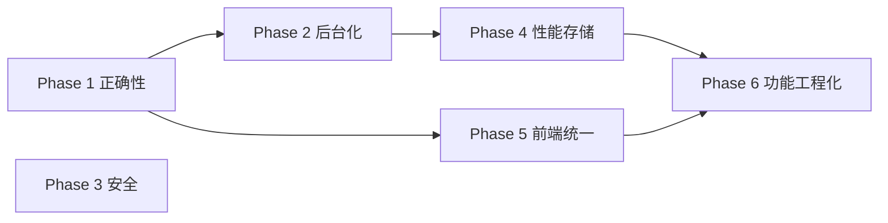

# v2 系统缺陷修复实施方案（六阶段）

> 制定日期：2026-08-26
> 适用范围：`v2/app/**`、`v2/scripts/**`、`v2/run.py`、`v2/requirements.txt`
> 前置文档：《前端缺陷修复实施方案》（四阶段，2026-08-25 已全部完成）。本方案覆盖其后全量审计发现的**后端 / 脚本 / 架构 / 工程化**问题，以及前端遗留的少量问题。
> 原则：不引入 Celery/Redis 等重依赖，后台任务基于进程内实现；每个 Phase 独立可验证、可单独上线；标注 *（决策项）* 的条目需先确认再实施。

---

## 审计发现总览（缺陷编号 D-xx）

### A. 正确性与数据一致性
| 编号 | 缺陷 | 主要位置 |
|---|---|---|
| D-01 | TTS 单条失败被静默跳过 → `speech_N` 序号空洞 → dump 仅 warning，record/compose 直接 raise，**导出链必然断裂** | `routers/tts.py`(generate-all)、`services/video.py`(dump)、`scripts/utils.py`(list_slides_and_audios) |
| D-02 | 失败占位文本流入产物：slide 失败写入「生成第 N 张幻灯片失败」被截图进 PPTX/视频；script 失败写入「（本节讲解暂缺…）」被 TTS 朗读 | `routers/slide.py`、`routers/script.py` |
| D-03 | 重新划分章节不失效下游：旧 slides/scripts/tts 原样保留，status 仍是「已完成」，has-final/has-pptx 指向陈旧产物，新章节可配旧讲解稿导出错位视频 | `routers/section.py`(split)、`routers/task.py`(sync_task_status) |
| D-04 | 删除任务只清 DB，`data/{taskId}/` 下 final.mp4、pptx、截图、音频全部残留，磁盘只增不减 | `routers/task.py`(DELETE) |
| D-05 | 音频接口无 Range/206 分段，`Content-Disposition: attachment` 应为 inline；`<audio>` seek 退化 | `routers/tts.py`(/audio) |
| D-06 | 时长链路三处隐患：① record 视频比音频多 1s 却被 compose `-shortest` 剪掉，意图矛盾；② ffprobe 失败静默回退 10s，音画不同步不报警；③ `full_page=True` 截图遇内容超高整图缩小加黑边，预览（可滚动）与成片（缩成一团）表现不一致 | `scripts/record.py`、`scripts/compose.py`、`scripts/utils.py` |
| D-07 | 尺寸口径不统一：分章 prompt 要求适配 1920×948，幻灯片 prompt 与录制均为 1920×1080 | `routers/section.py`(split prompt) |
| D-08 | 上传后端零校验：无大小限制、非 UTF-8 直接 UnicodeDecodeError→500（绕过前端直传时）；搜索 LIKE 未转义 `%`/`_` | `routers/task.py`(upload/list) |

### B. 架构与稳定性
| 编号 | 缺陷 | 主要位置 |
|---|---|---|
| D-09 | 长任务同步阻塞：generate-all/split/export 在单请求内串行调用 N 次 LLM/TTS（read 超时 600s），无真实进度、无法取消、断线无法恢复 | `routers/{section,slide,script,tts}.py`、`services/video.py` |
| D-10 | 无服务端并发互斥：刷新页面/双开标签即可对同一任务重复触发，互相覆盖数据、ffmpeg 进程翻倍 | 所有写操作端点 |
| D-11 | SQLite 未设 busy_timeout/WAL，生成过程长事务持有 session 分钟级，并发写报 `database is locked` | `app/database.py` |
| D-12 | 脚本低效：record/screenshot **每张幻灯片新建一个 Chromium 实例**；静态图用 `-r 60 -crf 16` 编码，耗时与体积放大数倍 | `scripts/record.py`、`scripts/screenshot_slides.py` |
| D-13 | 子进程 `timeout=300` 硬编码，页数多必撞上限，超时即全盘失败、无断点续跑 | `services/video.py`（4 处） |
| D-14 | requirements.txt 缺 `jinja2`（新环境装完即启动失败）；未说明 `playwright install chromium` 与系统 ffmpeg 依赖 | `requirements.txt` |

### C. 安全
| 编号 | 缺陷 | 主要位置 |
|---|---|---|
| D-15 | API 全裸奔（列表/详情/删除/下载/导出无任何鉴权）；run.py 以 `0.0.0.0` + `reload=True` 对局域网暴露开发服务器 | `run.py`、全部路由 |
| D-16 | X-API-Key 仅校验非空（本质是透传用户阿里云密钥）；密钥存 localStorage；主页面无 CSP 兜底 | `routers/*`、`templates/base.html` |
| D-17 | 幻灯片 iframe sandbox 含 `allow-popups`，AI 生成的 HTML 可 `window.open` 任意外部 URL（钓鱼面） | `routers/slide.py`、`static/js/task_create_steps.js` |

### D. 性能与存储
| 编号 | 缺陷 | 主要位置 |
|---|---|---|
| D-18 | list_tasks N+1：每行调两次 get_task_status，回退时再对 4 张子表各 count，首页最多 50+ 查询 | `routers/task.py`(list) |
| D-19 | 五张表 `task_id` 均无索引、task.task_id 无 unique 约束 | `app/models.py` |
| D-20 | TTS 音频以 LargeBinary 存 SQLite：数据库膨胀快且无法流式播放（与 D-05 同源） | `app/models.py` |
| D-21 | httpx 无重试；Qwen 未设 temperature/max_tokens/response_format；clean_json_response 只处理代码块包裹，模型前后带白话即解析失败 | `services/qwen.py`、`services/tts_api.py` |

### E. 功能设计
| 编号 | 缺陷 | 主要位置 |
|---|---|---|
| D-22 | 资源只能编辑/重生成，不能增删排序；TTS 卡片连编辑都没有；「重新生成」一律全表 DELETE 重建，重烧全部 API 费用 | 各 router + 前端 |
| D-23 | 任务不可重命名、不可替换课件（Step1 输入框 disabled）；同名任务可无限创建 | `task_create.js` |
| D-24 | TTS 音色/语言硬编码 Cherry/Chinese，英文课件也按中文合成，用户不可选 | `services/tts_api.py` |
| D-25 | 前端写操作约 15 处裸 fetch 不查 `r.ok`：服务端 500 返回 error.html 时 `res.json()` 抛 SyntaxError，用户看到 "Unexpected token '<'"；editSlide 连 catch 都没有 | `static/js/task_create_steps.js` |
| D-26 | 状态文案前后端双份维护且已漂移（后端「已生成幻灯片」vs 前端「幻灯片」） | `routers/task.py` vs `static/js/task_list.js` |
| D-27 | 分页条渲染全部页码，无省略号，百页任务时溢出 | `static/js/task_list.js` |
| D-28 | update 接口把 create_time 改为 now()，破坏时间语义 | `routers/{section,slide,script}.py` |

### F. 工程质量
| 编号 | 缺陷 | 主要位置 |
|---|---|---|
| D-29 | 死代码与空壳层：script.generate-all 的 context_parts 构建后从未使用；video.py 函数内重复 import；schemas 的 Out 模型基本未挂 response_model；services/pptx.py 整个文件只是 re-export | 见左 |
| D-30 | 配置散落硬编码：模型名、voice、600s HTTP 超时、分页 size=10、5MB 上限、300s 子进程超时分散各处，无环境变量集中管理 | 全局 |
| D-31 | 无任何测试；日志仅控制台无轮转；无 /healthz | 全局 |
| D-32 | 手写 `_run_migrations` 无版本管理（Alembic 缺失） | `app/database.py` |

---

## Phase 1：正确性与失败传播链（P0）

> ✅ 已实施（2026-08-26），自测 21/21 通过；顺带修复上传字段名 `taskName` 与后端 `Form` 参数不匹配导致的 UI 上传 422 bug。

### 1.1 失败显式建模 *（解决 D-01/D-02，Phase 2 进度展示的前置）*
- `slide`、`script` 两表新增 `status VARCHAR(10) NOT NULL DEFAULT 'ok'`（沿用 `_run_migrations` 的 ALTER TABLE 迁移模式）。
- generate-all 循环中单条失败：**不再写占位正文**，落一条 `content=''` + `status='failed'` 的记录，保证序号连续；by-task-id 接口下发 `status` 字段。
- `tts/generate-all`：失败/跳过同样必须落 `status='failed'` 占位记录（保住 `speech_N` 序号连续），message 汇总「成功 x 条、失败 y 条（序号：…）」。
- `dump_slides_and_audio`：数量或序号不一致时**直接返回 fail**并列出缺失/失败序号清单，删除现有 warning-继续分支。
- 前端（`task_create_steps.js`）：`status==='failed'` 的卡片渲染红色徽标「生成失败」+ 按钮「重试」（即原 regenerate）；Step6 导出确认弹窗在存在 failed 项时列出数量并警示。

### 1.2 下游失效联动 *（解决 D-03）*
- `section/split` 成功后级联删除该任务的 slides/scripts/tts 三表记录，`sync_task_status` 自然回到 `sections_done`；确认弹窗文案补充「将同时清除已生成的幻灯片/讲解稿/音频」。 *（决策子项：是否同时物理删除 `data/{taskId}/` 下的 videos/screenshots/final.mp4/presentation.pptx——推荐删除，避免陈旧产物误下载。）*
- `has-final`/`has-pptx` 增加新鲜度判断：比较产物 mtime 与该任务内容最后更新时间（Phase 1.5 引入 update_time 后更准确），过期时返回 `{exists: true, stale: true}`；前端对 stale 显示「课件已变更，建议重新导出」，不再直接当作「已完成」。

### 1.3 删除任务清理磁盘 *（解决 D-04）*
- `delete_task` 中 `shutil.rmtree(_task_dir(task_id), ignore_errors=True)`，路径拼接复用 `video.py._safe_task_id`。

### 1.4 上传与查询健壮化 *（解决 D-08）*
- upload：读入后校验 `len(content_bytes) <= 5MB`；`decode('utf-8')` 捕获 `UnicodeDecodeError` 返回 `Result.fail("文件必须是 UTF-8 编码")`；空内容拒绝。
- list 搜索：`task_name` 中的 `%`/`_`/`\` 转义后再 LIKE。

### 1.5 时间语义与口径统一 *（解决 D-28/D-07）*
- `section/slide/script/tts` 的 update/regenerate 停止改 `create_time`；task/section/slide/script/tts 各加 `update_time` 列（迁移），更新时刷新，列表接口下发。
- 分章 prompt 中 `1920×948` 改为 `1920×1080`。

### 1.6 依赖修复 *（解决 D-14）*
- requirements.txt 补 `jinja2`；README 增补安装说明：`playwright install chromium`、系统级 ffmpeg/ffprobe。

**Phase 1 验证**
1. 3 章任务人为令第 2 条 TTS 失败 → Step5 第 2 条显示失败徽标；dump 返回失败并列出序号 2；导出确认弹窗警示。
2. 重新划分章节 → slides/scripts/tts 清空、status 回「已分章」、Step3-6 引导重新生成；旧 final.mp4 若保留则 has-final 标记 stale。
3. 删除任务后 `data/{taskId}/` 目录不存在。
4. 直传 8MB / GBK 文件到 `/api/task/upload` → 返回业务错误（code!=200）而非 500。
5. 全新 venv `pip install -r requirements.txt` 后可直接启动。

---

## Phase 2：长任务后台化与脚本效率（P0，依赖 1.1）

> ✅ 已实施（2026-08-26），自测 21/21 通过（mock AI 全链路：提交→轮询→落库、重复提交互斥、部分失败传播、WAL/busy_timeout）。

### 2.1 进程内作业模型 *（解决 D-09/D-10）*
- 新增 `app/jobs.py`：`JOBS: dict[str, Job]`，key=`f"{step}:{taskId}"`，字段 `{state: running|success|failed|cancelled, stage, current, total, error, startedAt, result}`；执行体跑在 daemon Thread（内部自建 `SessionLocal()`，不复用请求 session）。
- 五类长操作（split/generate-all×3/export-final/export-pptx）改两段式：
  - `POST ...` 校验参数后立即投递并返回 `{jobState}`（HTTP 仍 200，Result.data 带 state，保持 Result 包装约定）；
  - 同一 key 已在 running → `Result.fail("该步骤正在执行中，请勿重复提交")`（服务端互斥，替代前端 disable）。
- 新增 `GET /api/task/job/{step}/{taskId}` 查询进度；终态保留至下次覆盖或 TTL 10 分钟。
- **取消能力预留**：新增 `POST /api/task/job/cancel/{step}/{taskId}`——对 running 任务置 `cancelled` 标志：LLM/TTS 循环在每轮迭代前检查标志并提前退出，ffmpeg 子进程调用 `terminate()` 终止。本期至少落地状态机位与端点骨架，前端「取消」按钮可后续补充。

### 2.2 前端轮询改造
- `doXxx` 提交后以 2s 间隔轮询 job 接口；`startElapsedTimer` 升级为阶段进度文案：`正在生成第 3/12 张 · 已耗时 45s`；终态停止轮询并 toast。
- 进入向导某步时若对应 job 为 running（刷新场景）自动恢复轮询态。

### 2.3 脚本效率与稳健 *（解决 D-12/D-13/D-06）*
- `record.py` / `screenshot_slides.py`：browser 实例提到循环外整批复用，逐页 `new_page()/close()`；ffmpeg 参数改 `-r 30 -preset veryfast -crf 18`（静态画面足够）。
- `video.py`：子进程超时按规模动态计算——`max(300, 90s × 页数 + 120s)`；compose 按 `max(300, 总音频时长×2)`。
- record 截图前 `page.evaluate("document.documentElement.scrollHeight")`，超过高度 +50px 时打 warning（幻灯片溢出预警）。
- `compose.py`：移除 `-shortest`（保留 record 的 +1s 尾部缓冲），二者矛盾取其一。
- `utils.get_audio_duration_ms`：失败改为抛 RuntimeError 由上层统一报错，删除静默 10s 回退。

### 2.4 SQLite 并发参数 *（解决 D-11）*
- `connect_args` 增加 `timeout=30`（busy_timeout）；启动时执行 `PRAGMA journal_mode=WAL`。

> **边界说明（进程内方案的固有限制）**：Job 状态存内存、执行体为 daemon 线程——服务重启即丢失运行中任务与未查询的终态记录，正在运行的 ffmpeg 子进程随主进程一并退出（可能残留临时文件，可在启动时清理 `data/{taskId}/videos/` 半成品兜底）。单机单人场景可接受；若将来要求"重启不丢任务"，再评估引入外部队列/任务框架。

**Phase 2 验证**
1. 12 张幻灯片 generate-all：POST 秒回；轮询看到 current 递增；中途刷新页面进度恢复；第二个标签页同任务重复提交被拒。
2. 12 页导出不再撞 5 分钟超时；成片尾部保留约 1s 缓冲。
3. 并发两个不同任务导出无 `database is locked`。

---

## Phase 3：安全加固（P1）

> ✅ 已实施（2026-08-26），决策项均按推荐档落地：3.2 口令门禁、3.3-A 宽松 CSP、3.4 服务端默认 SK。自测 A/B 双模式 20/20 通过。

### 3.1 暴露面收敛 *（解决 D-15 前半）*
- `run.py`：默认 `host=127.0.0.1`；host/reload 改读环境变量 `HOST`/`RELOAD`，README 给出生产启动命令（uvicorn 直启、关 reload）。

### 3.2 站点访问口令 *（解决 D-15 后半，决策项，推荐实施）*
- 环境变量 `APP_ACCESS_TOKEN` 设置后启用：轻量中间件校验 Cookie `app_token`（首次访问跳简易口令页，校验通过种 HttpOnly Cookie）；未设置该变量时行为与现状一致（本机单人使用零负担）。
- 保护范围：`/api/**` 与所有下载端点；`/static/**` 放行。

### 3.3 CSP 与 sandbox *（解决 D-16 后半/D-17）*
- 幻灯片 iframe sandbox 去除 `allow-popups`（后端 CSP 响应头与前端属性两处同步），AI 生成页禁止 `window.open`。
- base.html 增加 meta CSP。 *（决策项分两档：A 宽松版 `script-src 'self' 'unsafe-inline'` 可直接上线（现有大量内联 onclick）；B 严格版需将内联事件全部改为 addEventListener 绑定，列入长期重构，不在本方案排期。）*

### 3.4 SK 服务端托管 *（解决 D-16 前半，决策项）*
- 支持环境变量 `DASHSCOPE_API_KEY`：`chat()`/`synthesize()` 在收到空 key 时回退该默认密钥；SK 弹窗文案提示「留空则使用服务器默认密钥」。多人场景仍推荐各自配置。

**Phase 3 验证**
1. 局域网另一台机器访问 `http://<ip>:8000` 默认拒绝。
2. 设置口令后未登录调 `/api/task/list` 返回 401；口令页登录后正常。
3. 幻灯片页内 `window.open('https://example.com')` 被沙箱拦截；主页面响应含 CSP。

---

## Phase 4：性能与存储（P1~P2）

> ✅ 已实施（2026-08-26），自测 29/29 通过（Range/206、懒迁移、dump 复用磁盘文件、索引生效 EXPLAIN 验证、1000 任务列表 19ms、chat 参数与重试配置）。

### 4.1 音频落盘 *（解决 D-20/D-05）*
- Tts 表加 `file_path` 列（迁移）；synthesize 成功后写 `data/{taskId}/audios/tts_{order}.mp3`，DB 存相对路径，`content` 大字段停用（保留列做兼容）。
- `/api/tts/audio` 改 `FileResponse`（自动获得 Range/206 与 ETag），`Content-Disposition` 改 inline。
- 旧数据兼容：`file_path` 为空但 `content` 非空的行，首次访问懒落盘并回填。
- `dump_slides_and_audio` 直接复用已落盘文件，不再从 DB 读 blob。

### 4.2 索引与约束 *（解决 D-19）*
- `_run_migrations` 追加：五张子表 `CREATE INDEX IF NOT EXISTS idx_{table}_task ON {table}(task_id)`；存量查重后给 `task.task_id` 建 unique index。

### 4.3 列表查询优化 *（解决 D-18）*
- list_tasks 改为一次性聚合：四张子表各一条 `group_by(task_id)` count 查询组装 map，行内直取；删除循环内 get_task_status 双调用。

### 4.4 HTTP 客户端与 Qwen 参数 *（解决 D-21）*
- `qwen.py`/`tts_api.py`：`httpx.Client(transport=httpx.HTTPTransport(retries=2))` 复用连接并做连接级重试。
- chat payload 增加 `temperature=0.3`、`max_tokens`（分章/JSON 类 4k、HTML 类 8k）；JSON 输出尝试启用 `response_format={"type":"json_object"}`（需对 qwen-plus 实测，不支持则维持 prompt 约束并强化解析）。
- `clean_json_response` 增强：截取首个 `{` 到最后一个 `}` 再解析；解析失败时异常信息附原始返回前 200 字便于排查。

**Phase 4 验证**
1. `<audio>` 拖动进度条时网络面板出现 206 Partial Content。
2. 造 1000 任务数据，列表接口响应 <100ms，EXPLAIN QUERY PLAN 走索引。
3. 模拟网络瞬断，连接级重试生效不报错。

---

## Phase 5：前端统一与体验修补（P2）

### 5.1 apiFetch 全面接管 *（解决 D-25）*
- `doSplitSections/doGenSlides/doGenScripts/doGenTTS/doDumpAndExport/regenSection/regenSlide/regenScript/regenTTS/editSection/editScript/editSlide`（约 12 处）统一改用 `apiFetch`；`editSlide` 补 catch 错误提示。删除各处手写 `X-API-Key` header 与 `code!==200` 样板。

### 5.2 状态文案单一来源 *（解决 D-26）*
- 删除 `task_list.js` 的 `STATUS_LABEL` 映射，直接渲染后端下发的 `statusLabel`（配色映射 STATUS_BADGE 保留本地）。

### 5.3 失败项 UI（承接 Phase 1.1）
- failed 卡片：红色边框 + 「生成失败」徽标 + 「重试」按钮；Step6 导出确认弹窗统计失败项数量。

### 5.4 分页省略号 *（解决 D-27）*
- `renderPagination`：首页/末页恒显 + 当前页 ±2，其余以 `…` 折叠。

**Phase 5 验证**
1. 停服后点击任意生成按钮 → toast 显示归一化错误信息（不再出现 "Unexpected token '<'"）。
2. grep 确认前端无第二份中文状态映射。
3. 造 200 条任务，分页控件显示省略号且可跳转。

---

## Phase 6：功能补齐与工程化（P2，含决策项）

### 6.1 任务重命名 *（解决 D-23 前半）*
- 新增 `PUT /api/task/rename`（taskId + taskName，≤50 字校验）；Step1 任务名输入框对已有任务解禁。

### 6.2 章节级删除与排序 *（解决 D-22，决策项）*
- 采用简化方案：只在**章节维度**提供「删除」「上移/下移」；操作成功后级联清空该任务 slides/scripts/tts 并回到对应步骤强制重新生成——避免三表序号联动的复杂度，同时保证导出配对永不错位。
- 端点：`DELETE /api/section/delete`、`POST /api/section/move`；操作前 confirmModal 明示「将清除下游全部生成结果」。

### 6.3 TTS 编辑入口与音色选择 *（解决 D-22 部分/D-24）*
- TTS 卡片增加「编辑讲解稿并重合成」入口（复用 script/update + tts/regenerate）。
- Task 表加 `tts_voice` 列（迁移，默认 Cherry）；Step5 增加音色下拉（DashScope 支持的音色清单），synthesize 参数化。英文课件多语言支持列入 backlog，本期不做。

### 6.4 死代码清理 *（解决 D-29）*
- 删除 script.generate-all 的 context_parts 死代码、video.py 函数内重复 import；schemas 的 Out 模型挂载到对应 by-task-id 的 response_model（或删除不用者）；`services/pptx.py` 并入 `video.py` 后删除。

### 6.5 配置集中 *（解决 D-30）*
- `config.py` 统一收口并支持环境变量覆盖：`QWEN_MODEL`、`TTS_MODEL`、`TTS_VOICE`、`HTTP_TIMEOUT`、`JOB_TIMEOUT_BASE`、`PAGE_SIZE`、`UPLOAD_MAX_MB`；routers/services 全部改引用 config，消除散落魔数。

### 6.6 测试、日志与健康检查 *（解决 D-31/D-32）*
- pytest：API 层（upload 校验 / split 以 mock qwen / export 以 mock subprocess / jobs 互斥）+ scripts 纯函数（utils 序号校验、compose 配对校验）。
- logging 增加 `RotatingFileHandler(logs/app.log, maxBytes=10MB, backupCount=5)`。
- 新增 `GET /healthz`（检查 DB 连接）。
- Alembic 引入与否列为决策项：表结构稳定期可继续 `_run_migrations`，但每次结构变更必须在本方案登记。

**Phase 6 验证**
1. `pytest` 全绿；CI（如启用）通过。
2. logs/app.log 产出并按大小轮转；`/healthz` 返回 200。
3. 重命名任务后列表与 Step1 即时生效；删除/移动章节后下游被清空且状态正确回落。

---

## 里程碑与依赖关系

- 建议执行顺序：**1 → 2 → 3 → 4 → 5 → 6**；Phase 3 无前置依赖，可视需要与 Phase 2 并行。
- 决策项汇总（需先确认）：1.2 是否物理删除旧导出产物、3.2 站点口令、3.3 CSP 档位、3.4 服务端默认 SK、6.2 章节级删排交互、6.6 Alembic。

## 附：本期明确不处理事项
- 幻灯片 CSS/JS 动画的视频化录制（现方案为静态截图，动画支持需 Playwright 录屏，另立专项）。
- 英文/多语言课件的 TTS。
- 多用户账号体系（3.2 口令仅为站点门禁，不是账号系统）。
- 引入前端框架或构建链（维持原生 JS + Jinja2 路线）。
